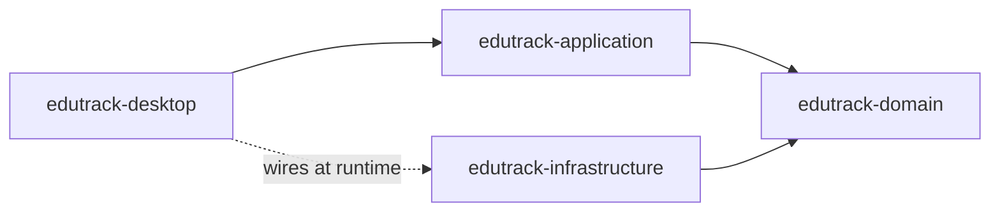

# EduTrack

A desktop app for planning and tracking your educational goals, from broad areas down to concrete roadmap steps.

EduTrack organizes learning as **areas** (for example "English", "Technologies" or "Consulting"), each holding **goals**, each with a **roadmap** of ordered **steps**. Progress is never typed in by hand: it is measured from the steps you have finished, weighted by their estimated hours. The interface follows a formal "Graphite" visual identity with a light and a dark theme.

It is a portfolio and learning project that applies Java, JavaFX, Spring Boot, PostgreSQL, Clean/Hexagonal architecture and SOLID principles (see `context.md` for the original vision).

## Features

- **Overview** screen with the progress of every area at a glance; on first launch it offers to create suggested areas (English, Technologies, Consulting).
- **Area tabs**: one tab per area, with its own icon and overall progress.
- **Goal cards** listing each goal with title, deadline and progress.
- **Goal panel** with the goal's details and its estimated effort (for example "10 / 38 h").
- **Vertical roadmap timeline**: ordered steps with clickable status marks (Not started, In progress, Done), reordering and editing; each step shows what was recorded ("Notes · 3 resources · Exercises 2/5").
- **Learning record per step**: open a step to keep everything learned about it:
  - **Notes** in Markdown (tables, task lists and strikethrough included), in one unified editor that is formatted as you type (toolbar, `/` block menu, shortcuts, `++underline++` and `==highlight==`), saved automatically, also when the app closes;
  - **Resources**: courses, articles, videos, books and documentation, with links and a "reviewed" mark;
  - **Exercises**: a practice checklist;
  - **Results**: formal scores from tests, exams and certificates (e.g. "IELTS mock test · 6.5 / 9 · 72%").
- **Goal results**: final exams and certificates recorded on the goal itself.
- **Dialogs** to create and edit areas, goals and steps, plus **delete confirmations**.
- **Light / dark theme** with a seamless crossfade, a remembered preference and a themed Windows title bar.
- **Friendly start-up errors**: if the database is unreachable or misconfigured, a dialog explains what to fix instead of a stack trace.

- **Sidebar navigation**, English / Spanish interface and a Settings page.
- **Study sessions**: free timer or Pomodoro, manual entries, practice routines, pace against the plan, weekly target and a planned date per step.
- **Today** page: streak, weekly review, cards due, routines, agenda and overdue goals.
- **Journal** with notes and weekly check-ins, and **Insights** charts (hours per week, study calendar, goal progress, measure trends).
- **Competencies and measures**, with results recorded in parts.
- **Review**: flashcards scheduled with SM-2, plus Evidence and Files tabs (attachments are copied into `~/.edutrack/files`).
- **Search** across everything (`Ctrl+K`).
- **Backups and restore** from Settings → Data (manual, plus an automatic weekly backup on start-up).
- **Export** a goal's notes (Markdown), cards and results (CSV) from the goal menu.
- **Templates**: seven built-in goal templates (English and Spanish), "New goal from template", "Save as template", and template file import/export.
- **Windows integration**: tray icon, minimize to tray, reminder notifications and start with Windows (all optional, in Settings).
- **Installer**: `mvn -P installer -pl edutrack-desktop -am package -DskipTests` builds an MSI with jpackage (needs WiX Toolset 3.x; JDK 23 does not support WiX 4+). For a portable folder use `-Dinstaller.type=app-image "-Dinstaller.extraArgs="`; the result is in `edutrack-desktop/target/installer`.
- **Release for sharing**: `scripts\build-release.ps1` puts everything to send in `release\`:
  - `EduTrack-0.1.0.msi`: per-user install to `%LOCALAPPDATA%\EduTrack`, with a Start menu entry and a desktop shortcut; newer MSIs upgrade in place.
  - `EduTrack.mcpb`: a Claude Desktop extension with an `open_edutrack` tool, so Claude can start the app (source in `claude-extension/`).
  - `INSTALL.txt`: the steps for recipients. They install PostgreSQL 18, then run `first-run.cmd` from `%LOCALAPPDATA%\EduTrack\app` to create the database and the configuration file.

  Windows does not let installers pin apps to the taskbar. Right-click EduTrack in Start and choose **Pin to taskbar**.

A desktop shortcut can point to `scripts\run-edutrack.cmd` (run minimized) with the icon `edutrack-desktop\src\main\resources\icons\app-icon.ico`.

## How progress is calculated

All rules live in `ProgressCalculator` (domain module).

- **Goal %** = hours of steps that are Done / hours of all steps.
- A step with no estimate, or an estimate of 0 h, weighs **1 h** in the percentage. The panel shows only the hours you entered, e.g. "33 / 194.5 h · 1 step without estimate", or "1 of 4 steps" when nothing is estimated.
- A goal with no steps is at **0%**.
- **Area %** = done hours of all its goals / their total hours, with the same weights. Bigger goals weigh more, and goals without steps are left out (0% with no hours).

Example: steps of 10 h (Done), 20 h (In progress) and 8 h (Not started) give 10 / 38 h = **26%**.

## Tech stack

| Concern | Technology | Version |
|---|---|---|
| Language | Java | 23 |
| Application framework | Spring Boot | 4.1.2 |
| UI | JavaFX | 25.0.5 |
| Theme | AtlantaFX | 2.1.0 |
| Icons | Ikonli (Feather pack) | 12.4.0 |
| Database | PostgreSQL | 18 (driver 42.7.14) |
| Migrations | Flyway | 12.4.0 |
| ORM | Hibernate (via Spring Data JPA) | 7.4.13 |
| Tests | JUnit Jupiter / AssertJ / Mockito | 6.0.3 / 3.27.7 / 5.23.0 |
| Architecture tests | ArchUnit | 1.5.1 |
| Build | Maven | 3.9+ |

AtlantaFX is pinned to 2.1 because the 3.x line requires Java 25, while this project targets JDK 23. Versions of Spring-managed libraries come from the Spring Boot 4.1.2 BOM.

## Architecture

EduTrack follows Clean / Hexagonal architecture, split into four Maven modules. Dependencies point inwards, towards the domain.



| Module | Responsibility | Depends on |
|---|---|---|
| `edutrack-domain` | Entities (`Area`, `Goal`, `RoadmapStep`, `LearningRecord`), value objects, progress rules, repository ports | JDK only |
| `edutrack-application` | Use cases (`AreaService`, `GoalService`), commands and read models | domain |
| `edutrack-infrastructure` | JPA entities, mappers, repository adapters, Flyway migrations | domain |
| `edutrack-desktop` | JavaFX UI, ViewModels, theme, Spring Boot entry point and wiring | application (infrastructure at runtime) |

Key decisions:

- **Framework-free core**: domain and application have no Spring or JPA annotations; services are wired as beans in `ApplicationConfig` (desktop module).
- **Ports and adapters**: repository interfaces live in the domain; `JpaAreaRepositoryAdapter` and `JpaGoalRepositoryAdapter` implement them, with hand-written mappers between domain objects and JPA entities.
- **Separate learning-record aggregate**: notes, resources, exercises and results live in `LearningRecord` (one per step or goal), not inside `Goal`, so screens that list goals never load large notes. A record is created on the first save and deleted with its owner (database cascade).
- **Flyway owns the schema** (`V1__init_schema.sql`, `V2__learning_records.sql`, which also moved the old step links into resources); Hibernate runs with `ddl-auto=validate`.
- **Native Markdown preview**: notes are parsed with commonmark and drawn as JavaFX nodes styled by the same design tokens, so the preview follows the light/dark theme (no WebView).
- **MVVM with FXML**: controllers only bind controls to ViewModels, which hold the UI state and logic and are unit-tested without JavaFX views.
- **`DataChanges`**: an app-wide "something was saved" signal so tab headers, Overview and goal cards refresh after any edit.
- **`FormDialogs`**: a single helper that builds all form dialogs consistently (validation, buttons, theming).
- **ArchUnit rules** (`ArchitectureTest`) guard the layers: the UI never touches infrastructure, the domain depends only on the JDK, the application layer is framework-free, and domain packages have no cycles.

## Visual identity

"Graphite, super formal": neutrals carry the layout, and a navy accent is reserved for selection, progress, focus, the primary button and status marks. Colors are defined only in `theme/tokens-light.css` and `theme/tokens-dark.css`; `base.css` consumes them.

| Token | Light | Dark |
|---|---|---|
| `-et-accent` | `#1E3A8A` | `#7C93D1` |
| `-et-accent-muted` (focus ring) | `rgba(30, 58, 138, 0.35)` | `rgba(124, 147, 209, 0.40)` |
| `-et-accent-subtle` (selection, hover) | `rgba(30, 58, 138, 0.07)` | `rgba(124, 147, 209, 0.10)` |
| `-et-on-accent` | `#FFFFFF` | `#0F1115` |
| `-et-text` | `#111827` | `#E5E7EB` |
| `-et-text-muted` | `#6B7280` | `#9CA3AF` |
| `-et-border` | `#E5E7EB` | `#2A2F38` |
| `-et-background` | `#FFFFFF` | `#0F1115` |
| `-et-surface` | `#F8F9FA` | `#16191F` |
| `-et-danger` (delete confirmation only) | `#9B1C1C` | `#E08A8A` |

- **Typography**: Inter (Regular, Medium, SemiBold), 13 px body, 20 px page titles, 15 px section titles, 11.5 px captions.
- **Shape**: 3 px corner radius, 1 px borders, no shadows.
- **Icons**: Feather via Ikonli, used sparingly.
- **Status marks**: ○ Not started, ◐ In progress, ✔ Done.
- **Motion**: fades and glides between 150 and 400 ms, and a discreet completion banner when a goal reaches 100%.

## Getting started (Windows)

### Prerequisites

- JDK 23 or newer
- Maven 3.9+
- PostgreSQL 18, for example: `winget install --id PostgreSQL.PostgreSQL.18 --interactive`
- Optional: Gluon Scene Builder to edit the FXML files

### Steps

1. Create the role and databases (`edutrack` and `edutrack_test`). The script prompts for the new `edutrack` role's password:

   ```powershell
   & "C:\Program Files\PostgreSQL\18\bin\psql.exe" -U postgres -f scripts\setup-db.sql
   ```

   (The winget installer does not put `psql` on the PATH, hence the full path.) For a non-interactive run, add `-v edutrack_pw=<password>`.

2. Put the same password in `%USERPROFILE%\.edutrack\application.properties` (this file lives outside the repository and is never committed):

   ```properties
   spring.datasource.password=<the password you chose>
   ```

3. Build:

   ```powershell
   mvn install
   ```

4. Run, with any of:

   ```powershell
   java -jar edutrack-desktop/target/edutrack-desktop-0.1.0-SNAPSHOT.jar
   mvn -pl edutrack-desktop spring-boot:run
   scripts\run-edutrack.cmd
   ```

   `scripts\run-edutrack.cmd` can be double-clicked: it builds the jar on first use and starts the app without a console window.

### Where things live

| What | Location |
|---|---|
| Database | `localhost:5432`, database `edutrack`, user `edutrack` |
| Local configuration | `%USERPROFILE%\.edutrack\application.properties` |
| Logs | `%USERPROFILE%\.edutrack\logs\edutrack.log` |
| Theme preference | Per Windows user, stored with `java.util.prefs` (registry) |

## Testing

```powershell
mvn verify
```

- **Unit tests**: domain rules, application services (with mocks) and ViewModels.
- **ArchUnit rules**: layer and dependency checks in `ArchitectureTest`.
- **Integration tests** (`*IT`): JPA adapters against the local `edutrack_test` database, created by the setup script. Each test rolls back. `V2MigrationIT` replays the migrations in a separate schema to check that old step links become resources. PostgreSQL must be running.

Run `mvn verify` for the current counts; unit tests cover domain, application, ViewModels and system integration, and `*IT` tests cover persistence, backups and search against PostgreSQL.

## Project structure

```text
EduTruck/
├── context.md                     original project vision
├── pom.xml                        parent POM (versions, modules)
├── scripts/                       setup-db.sql, Windows launcher
├── edutrack-domain/               com.edutrack.domain
│   └── area, goal, progress, shared
├── edutrack-application/          com.edutrack.application
│   └── area, goal                 services, commands, read models
├── edutrack-infrastructure/       com.edutrack.infrastructure.persistence
│   └── src/main/resources/db/migration/V1__init_schema.sql
└── edutrack-desktop/              com.edutrack.desktop
    ├── startup/                   start-up error handling
    ├── ui/                        area, goal, roadmap, overview, dialog, main, common, theme
    └── src/main/resources/
        ├── application.yml
        ├── theme/                 tokens-light.css, tokens-dark.css, base.css
        ├── fonts/                 Inter + OFL.txt
        ├── icons/                 application icons
        └── com/edutrack/desktop/ui/   FXML views
```

## Development history

- Milestone 1: project skeleton, app shell and Graphite visual identity
- Milestone 2: domain model, progress rules and application services
- Milestone 3: PostgreSQL persistence with JPA and Flyway
- Milestone 4: desktop interface with area tabs, goal panel and roadmap timeline
- Milestone 5: README, Windows launcher and repository polish
- Milestone 6: learning record per step (Markdown notes, resources, exercises, results) and goal results
- Milestones 7-15: sidebar and settings, study sessions, Today, Journal, Insights, competencies, flashcards, search, backups, export, templates, tray integration and installer

## License and credits

- [Inter](https://rsms.me/inter/) typeface, bundled under the SIL Open Font License (`edutrack-desktop/src/main/resources/fonts/OFL.txt`).
- [Feather](https://feathericons.com/) icons through [Ikonli](https://kordamp.org/ikonli/).
- [AtlantaFX](https://github.com/mkpaz/atlantafx) JavaFX theme.

The project itself does not have a license file yet.
